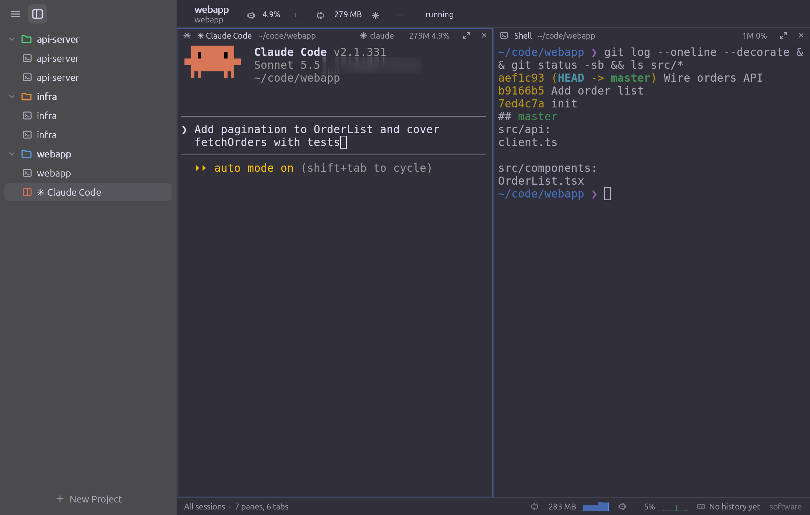
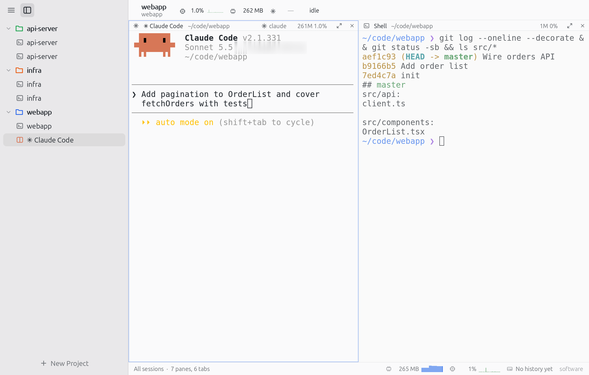

# keepterm

**keepterm is an AI-aware terminal.** It knows which coding agent runs in each pane, shows how full the agent's context window is, lets the agent drive the terminal itself, and brings the whole workspace back after a restart or a reboot: tabs, splits, folders, screens and the agent conversations.

One native executable, with or without a GPU, for:

- **Windows** 10 and 11, Windows Server 2016 and newer (x64)
- **macOS** 13 and newer (Apple silicon and Intel)
- **Linux** x86_64 with glibc 2.28 or newer (RHEL 8, Debian 10, Ubuntu 18.10 and newer)

| Dark | Light |
|---|---|
|  |  |

> **Status:** early development. Packages are on the [Releases](../../releases) page; changes are listed in [CHANGELOG.md](CHANGELOG.md).

## What it does for agents

- **Knows the agent.** Claude Code, Codex, Qoder CLI, Antigravity, Gemini CLI, Copilot CLI, Cursor Agent, OpenCode and Grok are recognized in a pane from the process tree; the tab shows which one runs. Your own CLIs go into `[[agents.custom]]`.
- **Shows the context.** For Claude Code, Codex, Qoder CLI and Antigravity, the tab shows how full the context window is, read from the agent's own session files. `keepterm --agent-limits` shows the Claude usage limits. Only usage numbers are read, never message text.
- **Lets the agent drive.** An MCP server (`keepterm mcp config` prints the `.mcp.json` entry) gives an agent everything the CLI can do: open tabs and splits, run a command in another pane, read its output, send keys, list and inspect sessions, search the history, read resources, config and themes. Its `search` tool finds a command and its arguments by keywords. Inside a pane, every command targets that pane by default; the CLI does the same for scripts.
- **Brings the conversation back.** After a reboot, a pane that ran Claude Code, Codex, Qoder CLI or Antigravity starts its shell in the same folder and resumes the same conversation (`--resume <id>` or the agent's equivalent).

## How it integrates

| With | How |
|---|---|
| Coding agents | Recognized from the running process; context read from their transcripts and databases (read-only) |
| Claude Code | Optional statusLine hook: `keepterm --agent-hook install claude` relays exact context figures |
| Any MCP client | `keepterm-mcp` bridge: tools to find and run every keepterm command |
| Scripts | `keepterm project\|tab\|pane\|window\|session\|layout ...`, `--json` output, shell completion for bash, zsh, fish and PowerShell |
| Shells | Shell integration for bash, zsh, fish and PowerShell: prompt marks and the current folder |
| Config | One `config.toml` with per-project overrides and live reload; a Settings window writes it |

## How it restores state

1. **Each pane is a separate session host process.** Closing the window, restarting keepterm or a GUI crash does not stop the shell, the build or the agent in it.
2. **The window reattaches.** On the next start keepterm finds its running hosts and reattaches every pane with its screen and scrollback intact.
3. **The workspace is saved.** Projects, windows, tabs, splits and every pane's folder are written to disk as you work.
4. **After a reboot, panes are rebuilt.** Each pane gets a new shell in its last folder, with the previous screen shown above a dim "restored" line.
5. **Agents are resumed.** The resume record of each agent is saved while it runs. Once the new shell is idle, keepterm types the resume command. It stops if you start typing first.

## Also

- **Projects, tabs and splits**, several windows per project, YAML layouts, a quick terminal on a global hotkey, private panes (no history on disk) and read-only panes.
- **Resource monitor:** memory and CPU per pane, tab and project with the whole process tree; `keepterm --resources --json` for scripts.
- **Command palette** with fuzzy matching, and keymaps per OS, fully rebindable.
- **Themes:** built-in light, dark and high-contrast, the iTerm2-Color-Schemes collection and Ghostty theme files; follows the OS light/dark mode.
- **Windows Server 2016 is a first-class target:** it has no ConPTY, so keepterm brings its own console agent there and uses ConPTY on newer Windows.
- **Nothing to install:** the C++ runtime and all third-party code are linked in. Renderers are Direct3D 11, Metal, Vulkan and a full CPU renderer; the CPU renderer is used without a GPU and over RDP.

## Platforms and downloads

| Package | System | Terminal backend | Renderers |
|---|---|---|---|
| `keepterm-Windows-x86_64.zip` | Windows 10, 11, Windows Server 2016 or newer, x64 | console agent (1607), ConPTY (1809+) | Direct3D 11, CPU |
| `keepterm-macOS-arm64.dmg` | macOS 13+, Apple silicon | POSIX pty | Metal, CPU |
| `keepterm-macOS-x86_64.dmg` | macOS 13+, Intel | POSIX pty | Metal, CPU |
| `keepterm-Linux-x86_64.tar.gz` | Linux x86_64, glibc 2.28+ | POSIX pty | Vulkan, CPU |
| `keepterm-Linux-x86_64.deb` | Debian, Ubuntu | POSIX pty | Vulkan, CPU |

On Linux the GUI runs on X11, and on Wayland through Xwayland. `SHA256SUMS` lists the checksums. The builds are not signed yet:

- **macOS:** System Settings → Privacy & Security → "Open Anyway", or `xattr -dr com.apple.quarantine /Applications/keepterm.app`.
- **Windows:** SmartScreen may warn: "More info" → "Run anyway".

## Building from source

CMake 3.28+, Ninja, and a C++20 compiler: MSVC 2022, Apple clang, or GCC or clang (tested: GCC 13 and 14, clang 18). All third-party code is in `third_party/`; nothing is downloaded.

```sh
cmake -S . -B build -G Ninja -DCMAKE_BUILD_TYPE=Release
cmake --build build
build/src/keepterm --version
```

On Windows, use a "x64 Native Tools" prompt of Visual Studio 2022. Packages: `cpack -G TGZ|DEB|DragNDrop|ZIP` in the build folder; `.github/workflows/release.yml` shows the exact release build.

## Not there yet

- A native Wayland backend, OpenGL, Vulkan on Windows, LCD subpixel text.
- Images in the terminal (sixel, kitty graphics), the kitty keyboard protocol.
- Remote projects over SSH, Windows arm64, Linux arm64 packages, signed builds.

## Credits and license

The workspace model and UX follow [Macterm](https://github.com/macterm/macterm) (macOS).

keepterm is licensed under the GNU General Public License v3.0, see [LICENSE](LICENSE). Third-party code in `third_party/` keeps its own licenses; `third_party/MANIFEST.toml` lists them, and every package carries them in `THIRD_PARTY_NOTICES.txt`.
